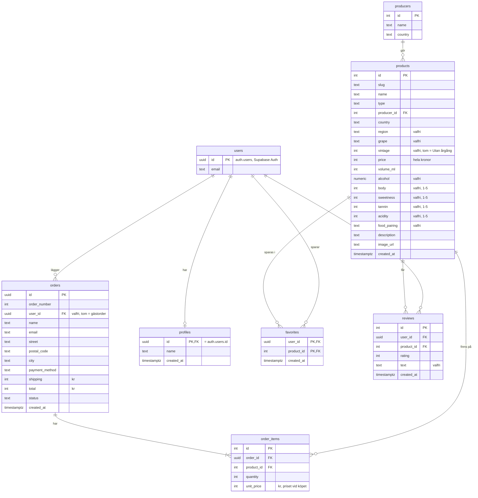

# ER: Korka Upp

- Row level security är påslaget utan policies på alla tabeller; all åtkomst går via servern
- `users` är Supabases egen `auth.users` och skapas inte i `db/setup.sql`
- `producers.name` är unik
- `products.slug` är unik
- `products.type` är en av `rott`, `vitt`, `rose`, `mousserande`, `dessert`, `orange`, `alkoholfritt` (check)
- `products.price` och `products.volume_ml` är större än 0 (check)
- `products.body`, `sweetness`, `tannin` och `acidity` är mellan 1 och 5 när de är ifyllda (check)
- `products.created_at` har `now()` som standardvärde; startsidan visar de fyra senaste
- Att radera en producent som har viner är spärrat (`products.producer_id` on delete restrict)
- `orders.id` får `gen_random_uuid()` som standardvärde; `orders.order_number` är unik och räknas upp automatiskt (identity)
- `orders.payment_method` är en av `kort`, `faktura`, `swish` (check)
- `orders.postal_code` är fem siffror (check)
- `orders.shipping` är 59 och `orders.status` är `mottagen` som standardvärden
- Att radera en användare sätter `orders.user_id` till tom; ordern finns kvar (on delete set null)
- Att radera en order raderar dess orderrader (`order_items.order_id` on delete cascade)
- Att radera ett vin som finns på en orderrad är spärrat (`order_items.product_id` on delete restrict)
- `order_items.quantity` är mellan 1 och 12 (check)
- Att radera en användare raderar dess profil, favoriter och recensioner (on delete cascade)
- Att radera ett vin raderar dess favoriter och recensioner (on delete cascade)
- `favorites` har primärnyckeln `user_id` + `product_id`, så ett vin kan bara vara favorit en gång per kund
- `reviews` är unik på `user_id` + `product_id`, så en kund kan bara recensera ett vin en gång
- `reviews.rating` är mellan 1 och 5 (check), och `reviews.text` är högst 1 000 tecken (check)
